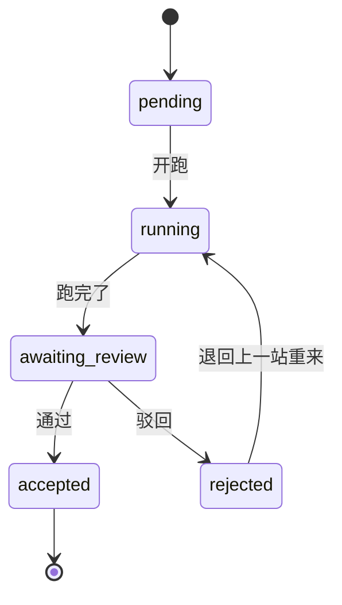

# AI 原生研发交付引擎

一条需求提进来，按顺序走过几站，每站由人或容器处理，通过了才往下走。整个平台是一个 Go 程序，浏览器打开就能用。

[](https://go.dev) [](https://vuejs.org) [](LICENSE) [](CHANGELOG.md) [](https://github.com/deepseek-ai/deepseek-harness)

## 一条需求怎么走

链条就是站的顺序。第一站固定是需求评估，最后一站固定是上线，中间可以放开发、跨端测试、合并：


「开发」和「合并」这两站是空的：你自己在分支上写代码、自己在仓库里合回主线，平台只记这站做完没做。其余几站平台会起一个容器让 agent 去干，干完把输出和结论贴进这一站的评论区。

需求现在停在哪一站，不单独存字段：从头数，第一个还没通过的站就是它当前的位置。

每一站内部只有五种状态：



驳回就是退回上一站，之前的记录一条都不删。如果第一站就被驳回，整条需求被拒。

## 跑起来

需要 Go 1.26 以上。前端文件已经放在仓库里，不用装 Node。

```bash
git clone https://github.com/Theodoree/ai_native_framework.git
cd ai_native_framework/apps/chain
go build -o chain .
./chain                                    # 打开 http://127.0.0.1:8099
```

页面没有注册入口。先建一个管理员：

```bash
./chain user add -username admin -password 至少八位的密码 -admin
```

之后所有账号都由管理员在「用户」页添加。

默认是 `-exec fake`：不真的跑容器，只写一条假评论，用来点页面。要真的起容器：

```bash
./chain assets                             # 把节点模板和镜像脚本解到 ~/.ai_native_framework
sh ~/.ai_native_framework/agent-image/build-images.sh
DEEPSEEK_API_KEY=sk-... ./chain -exec docker
```

## 从别的系统提需求

先在「我的密钥」页建一把 API 密钥（`ak_` 开头，只在建的时候显示一次），然后：

```bash
curl -X POST http://127.0.0.1:8099/api/intake/requirements \
  -H "Authorization: Bearer ak_..." \
  -H "Content-Type: application/json" \
  -d '{"project":"acme","context":"导出功能不支持 CSV，客户要"}'
```

再用 `GET /api/intake/requirements/{id}` 查结果。整条需求被拒时平台会往你给的回调地址发一次通知；发不出去也不影响需求状态，自己来查最靠谱。

## 它是什么

- **一个程序**：页面（Vue 3 + Arco Design Vue）、节点模板、镜像脚本都打在同一个二进制里，`./chain assets` 可以把模板和脚本展开到磁盘上改。
- **状态只有一处能改**：开跑、通过、驳回、评论、重启都走同一套状态机，接口层只做校验和转发。
- **人保留否决权**：合并不由平台代做；需要人审的站，按钮只有人按得动。
- **很小**：所有状态存在一个 SQLite 文件里（纯 Go 驱动，不用 cgo）。存储是接口，换数据库只要再写一个实现。

## 它不是什么

- 不是 CI：没有 required check，也没有 PR 门禁，判定不写在 YAML 里。
- 不管插件：想让某站的 agent 多会一件事，就写那一站的规则，规则只喂给容器。
- 不是人员目录：账号、项目里的角色、API 密钥，三样够用为止。

## 还没做的

完整清单和「开工前要先定什么」在 [docs/TODO.md](docs/TODO.md)，这里只列条目：

- [ ] k3s 接入（现在只有本机 `docker run`）
- [ ] MySQL 改造（`Store` 是接口，目前只有 SQLite 一个实现）
- [ ] 多实例（单机单写者，库是本地文件）
- [ ] 真节点镜像端到端（三个 Dockerfile 从没跑过真 agent）
- [ ] 接入层回告的重试与签名（现在只发一次，失败只留一条事件）
- [ ] 项目级管理员（现在只有全局管理员）
- [ ] 审计日志（记到什么粒度、留存多久都还没定）
- [ ] 会话续期与自助找回密码（现在 7 天固定、只能管理员重置）
- [ ] 观测（只有 stdout 日志，无 metrics、无健康详情端点）
- [ ] 图片扫描与缩略（现在只按文件头认类型、不处理）
- [ ] 分支链条（只有线性六站，不能并行、不能停在两处）
- [ ] 前端窄屏汉堡菜单、权力快照自动刷新、多链对比视图

## 文档在哪

| 想了解                       | 看哪里                                                |
| ---------------------------- | ----------------------------------------------------- |
| 架构、分层、一次需求流过什么 | `docs/architecture.md`                                |
| 平台契约与全部 HTTP 接口     | `apps/chain/README.md`                                |
| 前端契约                     | `apps/web/README.md`                                  |
| 还没做的（k3s、MySQL 等）    | `docs/TODO.md`                                        |
| 为什么这么做、放弃了什么     | `.agents/notes/`                                      |
| 版本变更                     | `CHANGELOG.md`                                        |
| 工作规则                     | `AGENTS.md` / `docs/AGENTS.md` / `docs/principles.md` |

## 开发

```bash
cd apps/chain
GOCACHE=/tmp/gocache-chain go test ./...       # 状态机、存储、执行器、HTTP 端到端
gofmt -l *.go && go vet ./...                  # 格式与静态检查

cd ../../apps/web && npm ci && npm run build    # 改前端后重建，产物进 apps/chain/webui/dist
```

改了前端记得重建：产物是入库的，`go:embed` 打的就是它，忘了构建等于没改。
