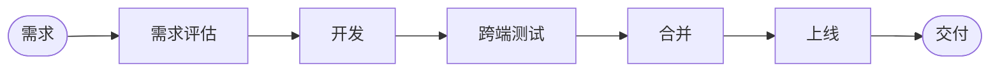
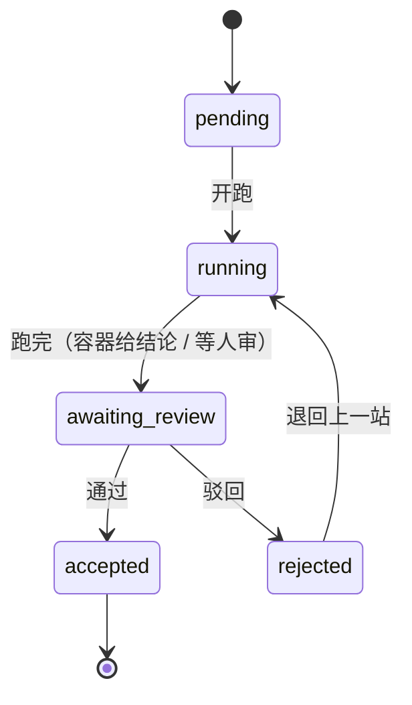

# AI 原生研发交付引擎

一条需求从提出到上线，中间只有两样东西：**链条**和**节点状态**。
没有独立编排器，没有 CI 门禁，也不依赖 GitHub 的任何一套机制——一个 Go 二进制，页面、节点模板、镜像脚本全在里面。

[](https://go.dev) [](https://vuejs.org) [](LICENSE) [](CHANGELOG.md) [](https://github.com/deepseek-ai/deepseek-harness)

## 它是怎么排的

链条是节点顺序的声明，节点类型封闭为六类，头必须是需求评估、尾必须是上线：



其中「开发」「合并」是空节点——人在分支上干活、在仓库里合回主线，平台只记状态；其余节点起容器跑 agent，跑完把执行记录与结论写进这一站的评论区。

需求此刻站在哪一层，由「第一个还没通过的节点」推导出来，不单独存一个位置字段：



驳回即回滚到上一站，历史一条不删；第一站被驳回等于整条需求被驳回。

## Quick Start

需要 Go 1.26+（前端产物已入库，不装 Node 也能跑）。

```bash
git clone https://github.com/Theodoree/ai_native_framework.git
cd ai_native_framework/apps/chain
go build -o chain .
./chain                                    # 打开 http://127.0.0.1:8099
```

第一次打开没有注册入口：先用命令行建第一个管理员 `./chain user add -username admin -password <至少 8 位> -admin`，之后所有人由管理员在「用户」页建账号。

默认 `-exec fake` 只写一条评论、不连外部服务。想接真容器：

```bash
./chain assets                             # 节点模板与镜像脚本展开到 ~/.ai_native_framework
sh ~/.ai_native_framework/agent-image/build-images.sh
DEEPSEEK_API_KEY=sk-... ./chain -exec docker
```

## 从平台外面提需求

在「我的密钥」页建一把 API 密钥（`ak_…`，secret 只出现一次），之后：

```bash
curl -X POST http://127.0.0.1:8099/api/intake/requirements \
  -H "Authorization: Bearer ak_..." \
  -H "Content-Type: application/json" \
  -d '{"project":"acme","context":"导出功能不支持 CSV，客户要"}'
```

拉结论走 `GET /api/intake/requirements/{id}`。整条需求被拒时会尽力回告一次，**回告失败不改状态**——拉模式永远是可信的那条路。

## 它是什么

- **一个二进制**：页面（Vue 3 + Arco Design Vue）`//go:embed` 进产物，节点模板与镜像脚本也在里面，`./chain assets` 就地展开。
- **状态只有一个写者**：跑、通过、驳回、评论、重启都经状态机，HTTP 层只做校验与搬运。
- **人保留否决权**：合并不由平台代做；人审节点的按钮只有人按得动。
- **够小**：SQLite（纯 Go 驱动，免 cgo）单文件存全部状态；`Store` 是接口，换库只加一个实现。

## 它不是什么

- 不是 CI：没有 required check、没有 PR 门禁，判定不发生在 YAML 里。
- 不做插件管理：想让某个节点的 agent 多会一件事，写那一站的规则（内容只进容器、每次执行重算）。
- 不做人员目录：账号、项目级角色、API 密钥三样，够用为止。

## 还没做的

完整清单与「开工前要先定什么」在 [docs/TODO.md](docs/TODO.md)，这里只列条目：

- [ ] k3s 接入（现在只有本机 `docker run`）
- [ ] MySQL 改造（`Store` 是接口，目前只有 SQLite 一个实现）
- [ ] 多实例（单机单写者，库是本地文件）
- [ ] 真节点镜像端到端（三个 Dockerfile 从没跑过真 agent）
- [ ] 接入层回告的重试与签名（现在只发一次，失败只留一条事件）
- [ ] 项目级管理员（现在只有全局管理员）
- [ ] 审计日志（记到什么粒度、留存多久都还没定）
- [ ] 会话续期与自助找回密码（现在 7 天固定、只能管理员重置）
- [ ] 观测（只有 stdout 日志，无 metrics、无健康详情端点）
- [ ] 图片扫描与缩略（现在只按文件头认类型、不处理）
- [ ] 分支链条（只有线性六站，不能并行、不能停在两处）
- [ ] 前端窄屏汉堡菜单、权力快照自动刷新、多链对比视图

## 文档在哪

| 想了解                       | 看哪里                                                |
| ---------------------------- | ----------------------------------------------------- |
| 架构、分层、一次需求流过什么 | `docs/architecture.md`                                |
| 平台契约与全部 HTTP 接口     | `apps/chain/README.md`                                |
| 前端契约                     | `apps/web/README.md`                                  |
| 还没做的（k3s、MySQL 等）    | `docs/TODO.md`                                        |
| 为什么这么做、放弃了什么     | `.agents/notes/`                                      |
| 版本变更                     | `CHANGELOG.md`                                        |
| 工作规则                     | `AGENTS.md` / `docs/AGENTS.md` / `docs/principles.md` |

## 开发

```bash
cd apps/chain
GOCACHE=/tmp/gocache-chain go test ./...       # 状态机、存储、执行器、HTTP 端到端
gofmt -l *.go && go vet ./...                  # 格式与静态检查

cd ../../apps/web && npm ci && npm run build    # 改前端后重建，产物进 apps/chain/webui/dist
```

改完前端记得重建：产物是入库的，`go:embed` 打的是它，忘了构建就等于没改。

## 贡献

见 `CONTRIBUTING.md`。安全问题请走 `SECURITY.md`，不要开公开 issue。

## License

MIT，见 `LICENSE`。
